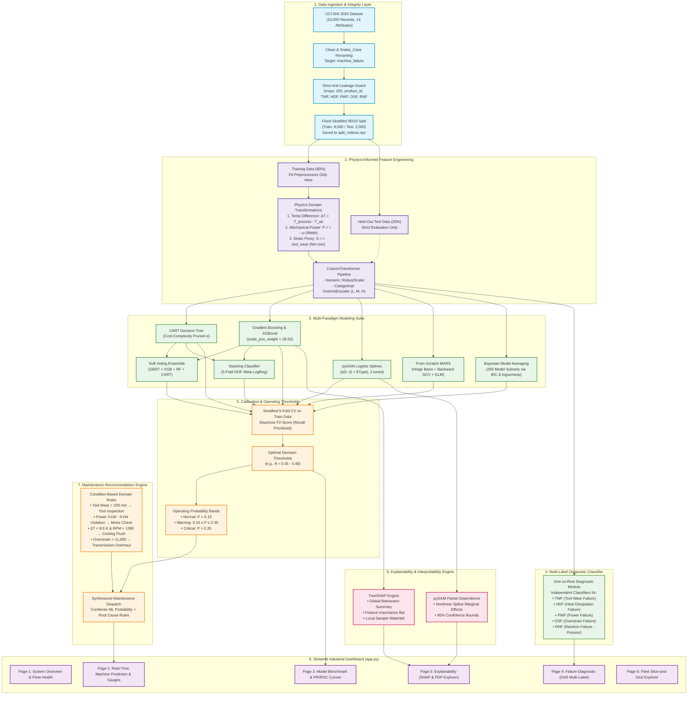

# Intelligent Predictive Maintenance System: End-to-End System Architecture

This document describes the architectural design and operational pipeline of the **Intelligent Predictive Maintenance System (AI4I 2020)**. The pipeline is designed around rigorous academic standards: zero data leakage, strict train/test split isolation, physics-informed feature transformations, comprehensive multi-model benchmarking (including standalone, ensemble, GAM, and from-scratch MARS architectures), explainable AI (SHAP and Generalized Additive Models), and condition-based prescriptive maintenance.

---

## High-Level Architecture Diagram

---

## Component Details

### 1. Ingestion and Anti-Leakage Guard
- **Source Dataset:** UCI Machine Learning Repository AI4I 2020 Predictive Maintenance Dataset (`data/ai4i2020.csv`), comprising 10,000 milling machine cycles across three product quality variants (`L`, `M`, `H`).
- **Forbidden Column Filter:** Automatically purges `UDI`, `Product ID`, and the five failure mode flags (`TWF`, `HDF`, `PWF`, `OSF`, `RNF`) before binary failure model consumption. The binary target `machine_failure` is derived from these flags; passing them constitutes severe data leakage.
- **Fixed Split Isolation:** Stratified 80/20 train/test split fixed with `random_state=42`. Row indices are persisted to `data/split_indices.npz` (8,000 train / 2,000 test; exactly 271 train failures / 68 test failures). Held-out test data is strictly isolated until final reporting.

### 2. Physics-Informed Feature Engineering
Derived from mechanical and thermodynamic principles governing milling tools:
1. **Temperature Difference ($\Delta T$):**
   $$\Delta T = T_{\text{process}} - T_{\text{air}} \quad [\text{Kelvin}]$$
   Captures thermal dissipation capability. Small $\Delta T$ combined with low air flow triggers Heat Dissipation Failure (HDF).
2. **Mechanical Power ($P$):**
   $$P = \tau \cdot \omega = \tau \cdot \left(\frac{2\pi \cdot \text{RPM}}{60}\right) \quad [\text{Watts}]$$
   Operating outside [3,000 W, 9,000 W] leads to Power Failure (PWF).
3. **Overstrain Proxy ($S$):**
   $$S = \tau \cdot \text{Tool Wear} \quad [\text{N}\cdot\text{m}\cdot\text{min}]$$
   Product of torque and cumulative tool wear. Exceeding variant thresholds ($11,000$ for L, $12,000$ for M, $13,000$ for H) causes structural Overstrain Failure (OSF).

### 3. Preprocessing Inside Pipelines
- **Continuous Sensors:** Robust scaling using median and IQR to guard against extreme operational excursions without leaking test distribution parameters.
- **Product Type:** One-Hot Encoding (`type_L`, `type_M`, `type_H`) inside scikit-learn `Pipeline` and `ColumnTransformer`.

### 4. Comprehensive Model Architectures
- **CART:** Scikit-learn `DecisionTreeClassifier` with minimal cost-complexity pruning ($\alpha$) tuned via Stratified 5-Fold CV on training PR-AUC.
- **Boosting Suite:**
  - AdaBoost (SAMME algorithm with stagewise exponential loss optimization).
  - Gradient Boosting (Greedy function approximation minimizing Bernoulli log-loss deviance).
  - XGBoost (Exact second-order Taylor expansion tree boosting with `scale_pos_weight = 28.52`).
- **Generalized Additive Models (GAM):** `pyGAM` `LogisticGAM` modeling continuous nonlinear effects via penalized B-spline terms:
  $$\text{logit}(p) = \beta_0 + s_1(\text{AirTemp}) + s_2(\text{ProcTemp}) + s_3(\text{RPM}) + s_4(\text{Torque}) + s_5(\text{Wear}) + f(\text{Type})$$
  Smoothing penalty $\lambda$ cross-validated on training log-likelihood.
- **From-Scratch Multivariate Adaptive Regression Splines (MARS):**
  - Zero dependency on obsolete packages (`py-earth`).
  - Hinge basis functions: $h(x, t) = \max(0, x - t)$ and $h(t, x) = \max(0, t - x)$.
  - Greedy forward step optimizing Residual Sum of Squares (RSS).
  - Backward pruning guided by Generalized Cross-Validation (GCV):
    $$\text{GCV}(M) = \frac{\frac{1}{N}\sum_{i=1}^N (y_i - \hat{f}_M(x_i))^2}{\left(1 - \frac{\tilde{C}(M)}{N}\right)^2}$$
  - Passed into a Logistic Generalized Linear Model (GLM mode) for binary failure probabilities.
- **Ensembles:**
  - **Soft Voting Ensemble:** Weighted probability averaging across Gradient Boosting, XGBoost, Random Forest, and CART.
  - **Stacking Classifier:** 5-fold out-of-fold meta-learner utilizing Logistic Regression.
- **Bayesian Model Averaging (BMA):**
  - Exhaustive enumeration across all $2^8 - 1 = 255$ non-empty predictor subsets.
  - Marginal likelihood approximated via Bayesian Information Criterion (BIC):
    $$P(D \mid M_k) \approx \exp\left(-\frac{\text{BIC}_k}{2}\right)$$
  - Numerically stable posterior model probabilities $P(M_k \mid D)$ computed via `scipy.special.logsumexp`.
  - Computes Posterior Inclusion Probabilities (PIP) and epistemic between-model predictive variance.

### 5. Multi-Label Diagnostic Engine
- Implemented in `src/failure_type_classifier.py` using One-vs-Rest gradient boosted decision trees.
- Addresses the 5 distinct failure mechanisms: `TWF`, `HDF`, `PWF`, `OSF`, and `RNF`.
- Explicitly handles the 9 unlabeled failure anomalies (flagged as generic mechanical failure) and 18 non-failure anomaly rows (RNF occurring without machine tripping).

### 6. Calibration & Decision Engine
- Optimal decision thresholds selected by maximizing the $F_2$-score on cross-validated training folds:
  $$F_2 = \frac{5 \cdot \text{Precision} \cdot \text{Recall}}{4 \cdot \text{Precision} + \text{Recall}}$$
- Operating bands established:
  - **Normal:** $P(\text{Failure}) < 0.15$
  - **Warning:** $0.15 \le P(\text{Failure}) \le 0.35$
  - **Critical:** $P(\text{Failure}) > 0.35$

### 7. Explainability and Recommendations
- **TreeSHAP:** Local additive feature attributions satisfying efficiency, symmetry, and additivity properties.
- **pyGAM Partial Dependence:** Direct visualization of non-linear log-odds shifts across sensor ranges.
- **Prescriptive Engine:** Domain-driven rules mapped directly to industrial maintenance actions (lubrication, cooling system flush, tool insert change, drive inspection).
